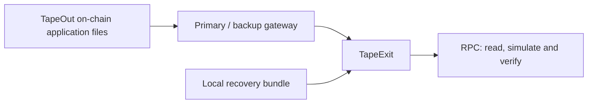
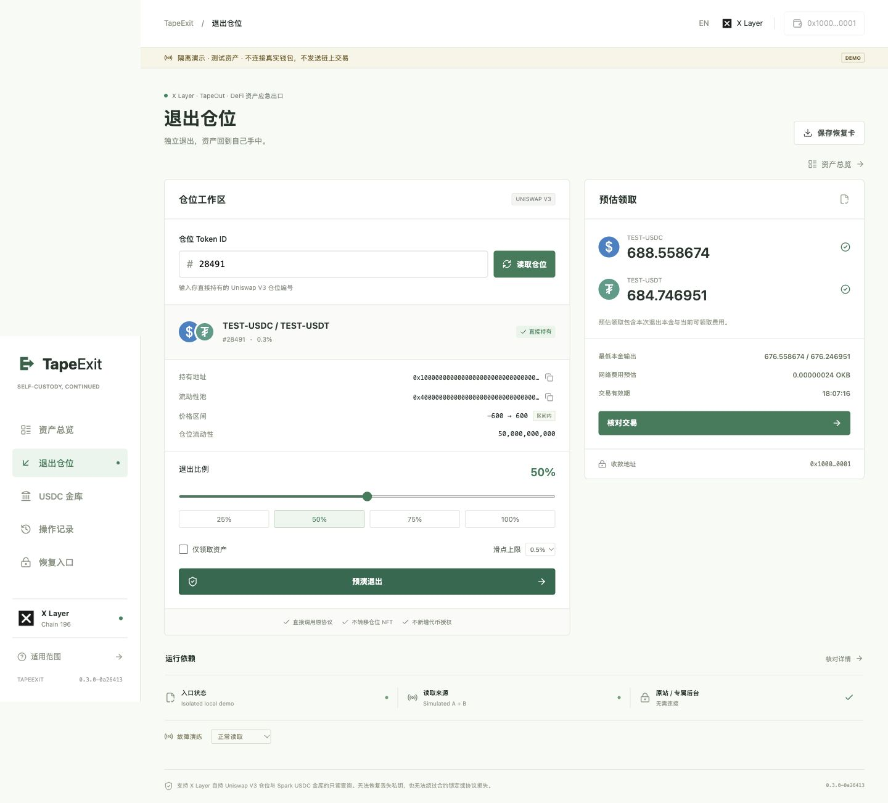
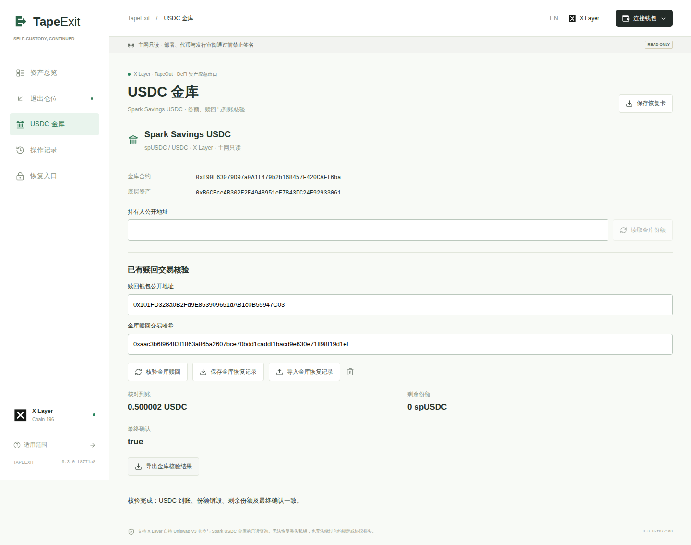

<picture>
  <source media="(prefers-color-scheme: dark)" srcset="docs/brand/tapeexit-wordmark-dark.png" />
  
</picture>

[中文](README.md) | [English](README.en.md)

# TapeExit

**An alternative path to your on-chain positions when the original website goes down.**

TapeExit is a **DeFi recovery interface for X Layer**, built on **TapeOut**. It uses on-chain application files, alternative gateways and a local recovery bundle to read positions, preview exits and verify receipts. Assets remain with the original wallet and protocol.

[**Try the demo, no wallet needed**](https://wangyangmingsss.github.io/tapeexit/) · [**Watch the pitch, Mandarin male narration, 2:22**](https://wangyangmingsss.github.io/tapeexit/pitch/?v=male-41851e6e) · [Mainnet read-only entry](https://2-2-289.netlify.app/) · [Backup entry](https://2-2-289.vercel.app/)

[**Download recovery bundle, 0.3.0-f8771a8**](https://github.com/wangyangmingsss/tapeexit/releases/download/v0.3.0-f8771a8/TapeExit-0.3.0-f8771a8-recovery.zip) · [Verify and run](docs/RECOVERY-QUICKSTART.md#english) · [Release record](https://github.com/wangyangmingsss/tapeexit/releases/tag/v0.3.0-f8771a8)

> **The public application is read-only. Production signing is disabled, and independent security review is pending.** The demo uses simulated assets. Completed real transactions were performed through separate, restricted test tools. See [current status](docs/CURRENT-STATUS.md) for the evidence and its scope.

## Why It Exists

A website outage does not necessarily remove a position from the blockchain. It can still leave users without a familiar interface to check receipts, evaluate an exit or avoid sending a transaction twice.

TapeExit provides **position reading, exit simulation, transaction verification and exportable recovery records** in an application users can obtain through another entry. If the original entry fails, users can switch gateways or run a previously downloaded bundle and recheck the chain.

## How TapeOut Fits

**TapeOut preserves the application entry. TapeExit implements protocol-specific exit and recovery workflows.**



The application is published as `2.2.289.tape`. Both public gateways read the same container and release manifest. The local recovery bundle contains matching application files. Future protocol adapters are built, checked and published with the application.

TapeOut does not hold assets or execute redemptions. Publishing on-chain does not guarantee permanent availability: access still depends on the container, a usable entry, RPC services and the chain. The local bundle needs a network connection. See the [integration and publication evidence](docs/evidence/published-f8771a8/README.md).

## Two Implemented Protocol Types

| Protocol | Position model | Available functionality |
| --- | --- | --- |
| **Uniswap V3** | Position NFTs directly held by the wallet, token pair and liquidity | Partial/full exit and collect-only previews; receipt, remaining liquidity and recovery checks for existing transactions |
| **Spark Savings USDC** | spUSDC shares held by a public address, asset equivalent and redemption limits | Proportional redemption previews; USDC receipt, share burn and finality checks for existing direct redemptions |

Exit plans call the corresponding original protocol contract, with the user as recipient. They add no custody, transfer no V3 NFT and perform no token swaps. V3 NFTs deposited in farms or other custody contracts are outside the current scope.

**V3 partial-exit preview with simulated assets:**



**Read-only verification of a real vault redemption, from backup-gateway acceptance:**



Screenshots use the Chinese interface. [Screenshot provenance](docs/screenshots/README.md) identifies their sources and versions. Simulated previews and real receipts are shown separately.

## Try It in Three Minutes

Open the [demo](https://wangyangmingsss.github.io/tapeexit/). No wallet or funds are required. The **EN** button switches the interface to English.

| Scenario | Steps | Expected result |
| --- | --- | --- |
| **V3 position** | Exit position, prefilled ID `28491`, Read position, `50%`, Simulate exit, Review transaction | Token pair, estimated receipt, target and recipient; a simulated confirmation lets you inspect the result |
| **USDC vault** | USDC vault, keep the prefilled simulated address, Read vault shares, `50%`, Simulate vault redemption | 50 simulated spUSDC shares; 25 shares burned and 25.5 USDC estimated; no real wallet signature |
| **Failure handling** | Return to Exit position, choose Inject RPC conflict or Interrupt operator under Fault rehearsal, then read again | The flow stops on conflicting or unavailable data instead of reporting a zero balance |

On mobile, open the navigation menu first. Demo balances, tokens and faults are simulated.

For real queries, use the [primary](https://2-2-289.netlify.app/) or [backup](https://2-2-289.vercel.app/) entry. Follow the wallet prompt and enter a directly held V3 position ID, or enter a public holder address on the vault page.
To recheck a real vault redemption, import the [public recovery example](docs/evidence/published-f8771a8/recovery-task.json) and select **Verify vault redemption**. Imported data provides hints only: the application rechecks the chain and does not resend a transaction.

## Recorded Verification

| Item | Result |
| --- | --- |
| **TapeOut publication** | `0.3.0-f8771a8`; 34 uploads confirmed; 16 files and 647,523 bytes read back byte for byte |
| **Gateway recovery** | Four fresh desktop/mobile-viewport sessions, 64 file checks; primary entry blocked before importing, reloading and rechecking a vault transaction through the backup |
| **Small V3 exit** | A restricted USDt0/USDC position exit, with received assets and remaining liquidity checked |
| **Real vault test** | 1 USDC deposited and redeemed in two parts; **1.000002 USDC** returned in total, zero shares remaining; all four transactions finalized |

[Publication and vault evidence](docs/evidence/published-f8771a8/README.md) · [Public recovery acceptance](docs/public-gateway-acceptance.md) · [V3 exit record](docs/CONTROLLED-TEST-67042.md) · [Automated checks](https://github.com/wangyangmingsss/tapeexit/actions/workflows/ci.yml)

Records apply to specific versions and observation times. They do not replace independent review or guarantee future availability. Source and demo continue to change; **the on-chain application and linked recovery bundle are pinned to `f8771a8`**. See [release channels](docs/RELEASE-CHANNELS.md).

## Roadmap

The goal is to extend the same recovery workflow to more X Layer protocols.

| Module | Status |
| --- | --- |
| Uniswap V3 and Spark USDC vault | Implemented and published; public application is read-only |
| V2 liquidity pools | Planned: remove liquidity using LP shares |
| Staking and yield farms | Planned: unstake, withdraw principal and claim rewards |
| Lending protocols | Planned: check debt and withdrawal conditions before exiting |
| Delayed redemption products | Planned: request an exit, track the waiting period and claim when eligible |

Each protocol needs its own adapter, verification and release. Coverage does not include all X Layer protocols. The application cannot bypass lockups, pauses or protocol losses. Developer entry points: [ProtocolAdapter](src/core/protocol-adapter.ts) and [adapter design](docs/PROTOCOL-ADAPTERS.md).

## Run Locally

Requires **Node.js 22.12 or later** and Git.

```sh
git clone https://github.com/wangyangmingsss/tapeexit.git
cd tapeexit
npm ci
npm run dev:demo
```

Open `http://127.0.0.1:4174`. For the mainnet read-only interface, run `npm run dev` and use the address printed in the terminal. To run without a development setup, [download the pinned recovery bundle](https://github.com/wangyangmingsss/tapeexit/releases/tag/v0.3.0-f8771a8) and follow the [verification and startup instructions](docs/RECOVERY-QUICKSTART.md#english).

<details>
<summary>Development checks and source layout</summary>

```sh
npm run typecheck
npm test
npm run build
npm run check:release
```

Before `npm run test:e2e`, run `npx playwright install chromium firefox webkit` and `npm run build:demo`. Some tests require a local EVM and permission to launch test browsers. Build outputs are `dist/` and `recovery/`.

| Directory | Contents |
| --- | --- |
| `src/`, `src/core/` | Interface, protocol reading, wallet connection, transaction and recovery verification |
| `src/demo/` | Isolated simulation |
| `tools/`, `tests/` | Build, release and automated verification |
| `docs/` | Operations, design and evidence |

</details>

## Documentation

Most detailed documents are currently in Chinese. Source files and evidence JSON retain technical identifiers in English.

| Topic | Start here |
| --- | --- |
| Competition pitch, video and materials | [Project](docs/competition/PROJECT.md), [submission checklist](docs/competition/SUBMISSION-CHECKLIST.md) |
| Current status and evidence scope | [Current status](docs/CURRENT-STATUS.md) |
| Recovery download, digests and startup | [Recovery quick start, English](docs/RECOVERY-QUICKSTART.md#english) |
| Export, import and recheck transactions | [Recovery workflow](docs/EXIT-RECOVERY-WORKFLOW.md) |
| Implemented and future protocols | [Adapters](docs/PROTOCOL-ADAPTERS.md) |
| Releases, gateways and on-chain publishing | [Release channels](docs/RELEASE-CHANNELS.md), [operations](docs/OPERATIONS.md), [TapeOut publishing](docs/PUBLISHING.md) |
| Risks and review materials | [Threat model](docs/THREAT-MODEL.md), [dependencies](docs/DEPENDENCY-REVIEW.md), [review handoff](docs/SECURITY-REVIEW-PACKET.md) |

## License

[MIT](LICENSE). Additional notices are in [docs/licenses/](docs/licenses/). Build artifacts include third-party notices.
