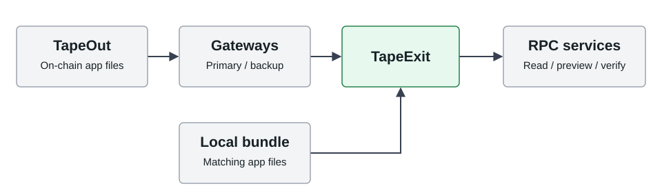

<picture>
  <source media="(prefers-color-scheme: dark)" srcset="docs/brand/tapeexit-wordmark-dark.png" />
  
</picture>

[中文](README.md) | [English](README.en.md)

# TapeExit

**原平台打不开时，给你的链上资产留一条退出路径。**

TapeExit 是基于 **TapeOut 协议**构建的 **X Layer DeFi 资产应急出口**：通过链上应用、备用网关和本地恢复包，继续查看仓位、预演退出、核对到账。资产始终由原钱包和原协议管理。

[**体验 Demo · 无需钱包**](https://wangyangmingsss.github.io/tapeexit/) · [**观看视频 · 普通话男声 · 2:22**](https://wangyangmingsss.github.io/tapeexit/pitch/?v=male-41851e6e) · [主网只读入口](https://2-2-289.netlify.app/) · [备用入口](https://2-2-289.vercel.app/)

[**下载恢复包 · 0.3.0-f8771a8**](https://github.com/wangyangmingsss/tapeexit/releases/download/v0.3.0-f8771a8/TapeExit-0.3.0-f8771a8-recovery.zip) · [校验与启动](docs/RECOVERY-QUICKSTART.md) · [发行记录](https://github.com/wangyangmingsss/tapeexit/releases/tag/v0.3.0-f8771a8)

> **当前公开版只读，生产签名关闭，独立安全审阅尚未完成。** Demo 使用模拟资产；已完成的真实交易来自单独的受限测试工具。各版本与证据范围见[当前状态](docs/CURRENT-STATUS.md)。

## 为什么需要它

原网站停止服务，不一定意味着链上仓位消失。但用户可能失去熟悉的操作页面，难以判断资产是否到账、能否退出，以及如何避免重复发送交易。

TapeExit 把这些步骤放进可另行获取的应用中：**读取仓位 → 预演退出 → 核对交易 → 保存恢复记录**。原入口失效后，可以换网关或运行提前下载的恢复包，再从链上重新核验结果。

## TapeOut 在其中的作用

**TapeOut 保存应用入口，TapeExit 适配退出与恢复流程。**



应用已发布至 `2.2.289.tape`。两个公网网关读取同一容器、同一发行清单；本地恢复包包含相同应用文件。后续协议模块也随应用版本构建、校验和发布。

TapeOut 不托管资金、不执行赎回。链上发布也不保证永久可用：访问仍依赖容器状态、可用入口、RPC 和区块链；本地恢复包需要联网。详见[集成与发布证据](docs/evidence/published-f8771a8/README.md)。

## 已支持的两类协议

| 协议 | 读取什么 | 当前可用能力 |
| --- | --- | --- |
| **Uniswap V3** | 钱包直接持有的仓位 NFT、币对、流动性 | 部分 / 全部退出及仅领取预览；已有交易的到账、剩余流动性与恢复核验 |
| **Spark Savings USDC** | 公开地址持有的 spUSDC 份额、折算资产、赎回上限 | 按比例赎回预览；已有直接赎回交易的 USDC 到账、份额销毁与最终确认核验 |

退出计划只调用对应的原协议合约，收款人为用户本人；不新增托管、不转移 V3 NFT、不兑换代币。V3 NFT 已存入农场或其他托管合约的情况尚不支持。

**V3 半额退出预览，使用模拟资产：**


**真实金库赎回后的只读核验，来自备用网关验收：**


截图来源与版本见[截图说明](docs/screenshots/README.md)。模拟预览与真实到账记录分别展示。

## 三分钟体验

打开 [Demo](https://wangyangmingsss.github.io/tapeexit/)，不需要安装钱包或准备资金。

| 场景 | 操作 | 你会看到 |
| --- | --- | --- |
| **V3 仓位** | “退出仓位” → 使用预填编号 `28491` → “读取仓位” → `50%` → “预演退出” → “核对交易” | 币对、预估领取、目标合约与收款人；确认模拟操作后可查看结果 |
| **USDC 金库** | “USDC 金库” → 保留预填模拟地址 → “读取金库份额” → `50%` → “预演金库赎回” | 50 spUSDC 的模拟持仓；销毁 25 spUSDC，预计到账 25.5 USDC；不会出现真实钱包签名 |
| **故障处理** | 回到“退出仓位”，在“故障演练”中选择 RPC 分歧或来源中断，再次读取 | 异常时停止流程，不把读取失败显示成零余额 |

手机上先打开菜单。Demo 只用于体验；其中的余额、币对和故障均为模拟。

真实查询请使用[主网入口](https://2-2-289.netlify.app/)或[备用入口](https://2-2-289.vercel.app/)：V3 按页面提示连接钱包、输入自持仓位编号；金库输入持有人公开地址即可查询。
已有金库赎回可导入[公开恢复示例](docs/evidence/published-f8771a8/recovery-task.json)，再点击“核验金库赎回”。导入只提供线索，结果必须重新查链，不会重发交易。

## 已完成的实际验证

| 项目 | 结果与证据 |
| --- | --- |
| **TapeOut 发布** | `0.3.0-f8771a8`；34 笔上传完成；16 文件、647,523 字节逐字节回读通过 |
| **双网关恢复** | 桌面 / 手机视口共四个新会话、64 次文件检查；阻断主入口后，从备用入口导入、刷新并重新核验金库交易 |
| **V3 小额退出** | USDt0 / USDC 仓位完成过一次受限退出，核对到账和剩余流动性 |
| **金库真实测试** | 1 USDC 存入后分两次赎回，合计到账 **1.000002 USDC**，份额归零；四笔交易最终确认 |

[发行与金库证据](docs/evidence/published-f8771a8/README.md) · [公网恢复验收](docs/public-gateway-acceptance.md) · [V3 退出记录](docs/CONTROLLED-TEST-67042.md) · [自动检查](https://github.com/wangyangmingsss/tapeexit/actions/workflows/ci.yml)

这些记录对应具体版本和观察时间，不替代独立审阅，也不保证未来在线。源码与 Demo 持续更新；**链上应用和上述恢复包固定为 `f8771a8`**。版本对应关系见[版本与交付](docs/RELEASE-CHANNELS.md)。

## 未来方向

目标是让同一套恢复流程逐步服务更多 X Layer 协议。

| 模块 | 当前状态 |
| --- | --- |
| Uniswap V3、Spark USDC 金库 | 两类适配已实现、已发布；公开版只读 |
| V2 LP | 规划：按 LP 份额移除流动性 |
| 质押与收益农场 | 规划：解除质押、提取本金、领取奖励 |
| 借贷平台 | 规划：核对债务与提取条件后退出 |
| 需要等待的赎回产品 | 规划：申请退出、跟踪等待、到期领取 |

每个平台需要单独适配、验证并发布，尚未覆盖 X Layer 全部协议；应急工具不能绕过锁定期、暂停或协议损失。开发入口：[ProtocolAdapter](src/core/protocol-adapter.ts) · [两类实现与扩展说明](docs/PROTOCOL-ADAPTERS.md)。

## 本地运行

需要 Node.js **22.12 或更新版本**和 Git。

```sh
git clone https://github.com/wangyangmingsss/tapeexit.git
cd tapeexit
npm ci
npm run dev:demo
```

打开 `http://127.0.0.1:4174`。主网只读界面使用 `npm run dev`，访问终端显示的地址。无需开发环境的用户可以[下载固定版本恢复包](https://github.com/wangyangmingsss/tapeexit/releases/tag/v0.3.0-f8771a8)，按[校验与启动说明](docs/RECOVERY-QUICKSTART.md)运行。

<details>
<summary>开发检查命令与代码结构</summary>

```sh
npm run typecheck
npm test
npm run build
npm run check:release
```

浏览器检查先执行 `npx playwright install chromium firefox webkit`、`npm run build:demo`，再运行 `npm run test:e2e`。部分测试需要本地 EVM，系统须允许启动测试浏览器。构建产物为 `dist/` 和 `recovery/`。

| 目录 | 内容 |
| --- | --- |
| `src/`、`src/core/` | 界面、协议读取、钱包连接、交易与恢复核验 |
| `src/demo/` | 隔离模拟 |
| `tools/`、`tests/` | 构建发布工具与自动化检查 |
| `docs/` | 操作说明、设计与证据 |

</details>

## 文档导航

| 想了解什么 | 文档 |
| --- | --- |
| 参赛介绍、视频和准备材料 | [项目介绍](docs/competition/PROJECT.md) · [参赛清单](docs/competition/SUBMISSION-CHECKLIST.md) |
| 当前状态与真实验证范围 | [当前状态](docs/CURRENT-STATUS.md) |
| 恢复包下载、摘要校验与启动 | [恢复包快速开始](docs/RECOVERY-QUICKSTART.md) |
| 交易后如何保存、导入与重新核验 | [恢复流程](docs/EXIT-RECOVERY-WORKFLOW.md) |
| 两类协议与未来接入 | [协议适配](docs/PROTOCOL-ADAPTERS.md) |
| 版本、网关与链上发布 | [版本与交付](docs/RELEASE-CHANNELS.md) · [发行手册](docs/OPERATIONS.md) · [TapeOut 发布](docs/PUBLISHING.md) |
| 风险与安全审阅资料 | [威胁模型](docs/THREAT-MODEL.md) · [依赖审查](docs/DEPENDENCY-REVIEW.md) · [审阅交接](docs/SECURITY-REVIEW-PACKET.md) |

## 许可证

[MIT](LICENSE)。补充许可见 [docs/licenses/](docs/licenses/)，构建产物附第三方许可清单。
