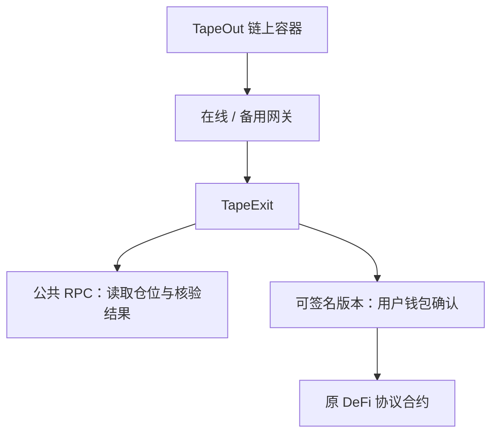

<p>
  <picture>
    <source media="(prefers-color-scheme: dark)" srcset="docs/brand/tapeexit-wordmark-dark.png" />
    
  </picture>
</p>

# TapeExit

**原平台打不开时，给你的链上资产留一条退出路径。**

TapeExit 基于 **TapeOut 协议**构建，目标是成为 **X Layer 的 DeFi 资产应急出口**，逐步覆盖流动性池、质押、收益金库和借贷平台。

**当前已实现的第一个适配模块是 Uniswap V3**：读取钱包直接持有的仓位、预览退出、核对到账，并通过备用网站或本地恢复包查询交易结果。

**TapeOut 保留链上应用入口，TapeExit 提供退出与恢复流程。** 应用文件发布在 X Layer 的 TapeOut 容器中，资产继续由原有钱包和协议合约管理，TapeExit 不接管资金。

[**在线演示 · 无需钱包**](https://wangyangmingsss.github.io/tapeexit/) · [主网只读入口](https://2-2-289.netlify.app/) · [备用入口](https://2-2-289.vercel.app/) · [下载恢复包](https://github.com/wangyangmingsss/tapeexit/releases/tag/v0.2.0-readonly-0d9ff56) · [详细文档](#文档导航)

首次体验可先打开在线演示：读取默认仓位 `28491` → 选择退出比例 → 预演并确认模拟退出，也可切换“故障演练”查看异常处理。演示使用测试资产，不发送真实交易。

> **当前公开版本为只读版，生产交易签名关闭。** 可以查看仓位、核对已有交易和使用恢复入口。演示模式使用模拟数据；真实退出曾在单独的受限测试中完成。完整钱包验收与独立安全审阅的证据状态见[实施状态](docs/IMPLEMENTATION-STATUS.md)。

## 它解决什么问题

资产存入 DeFi 协议后，如果原来的交易网站打不开，仓位和资产可能仍然在链上，但你失去了熟悉的操作页面。

TapeExit 为这种情况准备了三个入口：

| 入口 | 使用方式 |
| --- | --- |
| 在线入口 | 通过 TapeOut 网关访问链上发布的应用 |
| 备用入口 | 主入口不可用时，换一个网关读取同一容器 |
| 本地恢复包 | 提前下载，在自己的电脑上运行 |

本地恢复包仍然需要联网读取区块链，不是离线转账工具。

## 为什么结合 TapeOut

应急工具本身也需要一个能找回的入口。TapeExit 使用 TapeOut，把应用文件放进链上容器，让多个网关能够读取同一份已发布内容；本地恢复包则提供另一种运行方式。

| 组成 | 负责什么 |
| --- | --- |
| **TapeOut** | 承载应用文件，提供链上名称、容器与网关读取机制 |
| **TapeExit** | 读取资产、适配退出规则、展示预览并核对交易结果 |
| **用户钱包与原协议合约** | 由用户确认交易，按协议规则处理资产 |

各部分的关系：



TapeOut 保存的是应用文件。它不托管用户资金，也不替原 DeFi 协议执行赎回。未来接入的协议模块，也会随 TapeExit 的具体版本构建、校验和发布，而不是临时加载未核验的第三方代码。

**已有真实集成：** 应用已发布至 `2.2.289.tape`，完成容器激活、10 个文件逐字节回读，以及两个公网网关的访问和已有交易恢复检查。发布身份、文件摘要和记录见[链上发行证据](docs/evidence/published-0d9ff56/README.md)。

容器内容可以更新，所以每次发行需要保留对应版本的文件摘要并重新核对。访问仍依赖可用的网关或本地入口、容器状态、RPC 和链；链上发布不等于永久可用。

## 可以做什么

- **查看仓位**：读取币对、流动性和钱包所有权。
- **预览退出**：计算部分退出、全部退出或仅领取的结果，展示待核对的交易内容。
- **核对到账**：根据交易哈希，检查链上交易、领取记录和剩余流动性。
- **恢复查询**：导出公开的交易恢复文件，在其他入口导入后重新核验；新版源码支持刷新后恢复查询信息。

退出交易只调用原有仓位管理合约，接收地址固定为用户钱包。代码不申请新授权、不托管资产、不转移仓位 NFT，也不进行代币兑换。

**适用范围：** X Layer 主网、Uniswap V3、由钱包直接持有的仓位。已经存入农场或其他托管合约的仓位不在当前范围内。

## 未来方向

V3 是起点。我们希望用户以后只需要：**连接钱包 → 查看已接入协议的资产 → 按协议规则退出 → 核对到账**。

| 模块 | 当前进度 | 后续目标 |
| --- | --- | --- |
| Uniswap V3 | 已有实现；公开版只读 | 沿用现有仓位、退出预览与恢复能力 |
| TapeOut 链上入口 | 已完成一次实际发布与双网关检查 | 后续协议模块随应用版本发布并重新核验 |
| 多协议适配接口 | 已预留，V3 已实现该接口 | 为后续模块统一仓位读取与退出模拟接口 |
| V2 类流动性池 | 规划中 | 按 LP 份额移除流动性 |
| 质押与收益农场 | 规划中 | 解除质押、提取本金、领取奖励 |
| 收益金库 | 规划中 | 查看份额、预览并执行赎回 |
| 借贷平台 | 规划中 | 核对存款与债务，按协议条件提取资产 |
| 需要等待的赎回产品 | 规划中 | 申请退出、跟踪等待进度、到期领取 |

每个平台需要单独核对合约和退出规则，逐个接入。**上表中的规划项尚未支持，也不表示已覆盖 X Layer 全部平台。** 应急入口不能绕过协议锁定期、暂停或偿付条件。

开发者可从 [ProtocolAdapter 接口](src/core/protocol-adapter.ts)和[扩展说明](docs/PROTOCOL-ADAPTERS.md)了解如何接入。当前预留的是代码接口，尚无自动发现全部协议或加载第三方插件的功能。

## 先体验，再看代码

### 在线演示

打开 [Demo 网站](https://wangyangmingsss.github.io/tapeexit/)，无需安装或连接钱包，即可体验仓位读取、退出预览、模拟确认与故障演练。

### 在线查看

1. 打开[在线入口](https://2-2-289.netlify.app/)。
2. 按页面提示选择钱包，输入自己的仓位编号（Token ID）。
3. 查看仓位信息；已有交易可以通过恢复入口核验。

在线与备用入口目前运行已发布版本 `0.2.0-0d9ff56`。仓库中的后续改进需要单独发布，才会出现在公网入口。

### 本地演示

需要 **Node.js 22.12 或更新版本**，以及 Git。

```sh
git clone https://github.com/wangyangmingsss/tapeexit.git
cd tapeexit
npm ci
npm run dev:demo
```

打开 **http://127.0.0.1:4174**。演示不连接钱包、不发送真实交易，可以先熟悉仓位、退出预览和恢复流程。

### 本地主网只读界面

在项目目录运行：

```sh
npm run dev
```

打开终端显示的本地地址，查询自己直接持有的真实仓位。生产签名仍保持关闭。

## 已有的实际验证

| 项目 | 已有记录 |
| --- | --- |
| 链上发布 | 已发布并激活，10 个文件逐字节回读通过 |
| 双网关访问 | 已完成桌面、移动视图及主入口阻断后的已有交易恢复检查 |
| 小额真实退出 | USDt0 / USDC 仓位完成过一次受限退出，到账与剩余流动性已核对 |
| 自动化测试 | 包含核心计算、交易核验、恢复流程及 Chromium / Firefox / WebKit 浏览器测试 |

实际记录见[发行证据](docs/evidence/published-0d9ff56/README.md)、[公网网关验收](docs/public-gateway-acceptance.md)和[小额退出测试](docs/CONTROLLED-TEST-67042.md)。不同版本的测试结果分别记录，自动化测试不替代独立安全审阅。

## 开发与检查

常用命令：

```sh
npm run typecheck       # 检查类型
npm test               # 运行单元与集成测试
npm run build          # 构建应用和本地恢复包
npm run check:release  # 检查构建产物
```

运行浏览器测试前，先安装浏览器并完成构建：

```sh
npx playwright install chromium firefox webkit
npm run build
npm run build:demo
npm run test:e2e
```

部分测试需要本地 EVM；浏览器测试需要系统允许启动浏览器。环境受限时，查看对应提交的 [GitHub Actions](https://github.com/wangyangmingsss/tapeexit/actions) 结果。

构建后，`dist/` 是静态应用，`recovery/` 是本地恢复包。恢复包的摘要校验、启动和发布步骤见[发行操作手册](docs/OPERATIONS.md)。

## 文档导航

| 想了解什么 | 从这里开始 |
| --- | --- |
| 项目思路与参赛介绍 | [项目说明](docs/competition/PROJECT.md) |
| 已实现内容、版本与实际证据状态 | [实施状态](docs/IMPLEMENTATION-STATUS.md) |
| 多协议扩展接口与后续方向 | [协议适配说明](docs/PROTOCOL-ADAPTERS.md) |
| TapeOut 实际集成与发布身份 | [链上发行证据](docs/evidence/published-0d9ff56/README.md) |
| 退出后如何核对、刷新和恢复查询 | [交易恢复流程](docs/EXIT-RECOVERY-WORKFLOW.md) |
| 网关、本地恢复包和开发工具 | [发行操作手册](docs/OPERATIONS.md) |
| 如何发布到 TapeOut | [链上发布手册](docs/PUBLISHING.md) |
| 风险、信任边界与依赖 | [威胁模型](docs/THREAT-MODEL.md) · [依赖审查](docs/DEPENDENCY-REVIEW.md) |
| 独立安全审阅需要哪些资料 | [审阅交接](docs/SECURITY-REVIEW-PACKET.md) |

## 代码结构

```text
src/              应用界面与核心逻辑
src/core/         链上读取、钱包连接、交易核验与恢复
src/demo/         独立的模拟演示
tools/            构建、发布、网关和验证工具
tests/            单元、集成与浏览器测试
docs/             操作手册、设计说明与证据
```

## 许可证

[MIT](LICENSE)。补充许可文本见 [docs/licenses/](docs/licenses/)，构建产物另附第三方许可清单。
