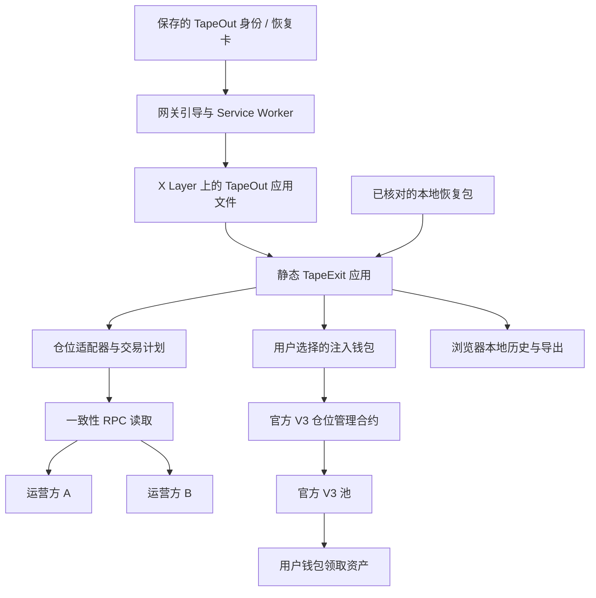

# TapeExit 完整开发方案

版本：1.0。编制日期：2026 年 10 月 27 日，北京时间。

项目状态：主题已获用户确认；本文件定义开发、验证和参赛交付，不表示软件已实现或已通过安全审查。

配套文件：

- `TapeExit-Implementation-Backlog.md`：任务编号、依赖、交付物与验收标准。
- `TapeExit-Verification-and-Sources.md`：事实核实、官方来源、未决问题及发布检查。
- `TapeExit-Theme.md`：前期主题说明；与开发方案冲突时，以本文件为准。

## 1. 项目目标与执行决策

### 1.1 产品定义

**TapeExit 是面向 X Layer 的 DeFi 独立退出入口。**

在原项目网页或专属后台不可用、底层协议仍可操作的情况下，用户通过提前保存的 TapeOut 入口或本地恢复包，读取自己的仓位、核对退出参数，用自己的钱包签名，将可领取资产收回自己的地址。

首版限定：X Layer、Uniswap V3、用户钱包直接持有的仓位 NFT、减少流动性和领取资产。

对用户的主张：

> 原站不可用时，保留一条自己核对、自己签名的仓位退出路径。

不得使用“永久可用”“任何资产都能救回”“协议被盗也能取回”“完全无信任”“零风险”等表述。

### 1.2 六项确定的架构决策

| 决策 | 执行方式 | 原因 |
| --- | --- | --- |
| 核心无必需后台 | 静态应用直接读取公开链上数据 | 原站或我们的业务后台停机不应阻断退出 |
| 不新增资金托管合约 | 用户直接调用官方仓位管理合约 | 限制新增权限与资金风险 |
| 不引入 Agent 代签 | 钱包逐笔呈现并由用户确认 | 紧急场景下保持操作可解释 |
| 不依赖索引器找仓位 | 手动输入 token ID 为保底；链上枚举为增强 | 避免 Graph/API 失效造成全流程中断 |
| 真实集成 TapeOut | 将生产应用文件发布到 X Layer 容器并实际加载运行 | 上链对象必须参与完成退出任务 |
| 版本固定、发布可核对 | 源码提交、文件清单、容器身份、合约配置一并固定 | 降低应急时临时更新与身份混淆风险 |

### 1.3 首版完成的定义

必须同时满足：

1. 用户能从 X Layer TapeOut 容器实际加载并运行应用。
2. 阻断原项目站点和专属后台后，仍能完成适用仓位的读取、模拟与退出。
3. 交易目标为经过核实的官方仓位管理合约，接收地址为当前签名账户。
4. 不要求 ERC-20 授权、NFT 转移或对 TapeExit 的 NFT 授权。
5. 账户、链、仓位状态改变时，旧交易计划立即失效。
6. 节点分歧、模拟失败或版本核对失败时，签名入口停止。
7. 用户能看见收据状态、实际领取证据和仍未确认的部分。
8. 备用网关与本地恢复包至少各完成一次独立演练。
9. 对外材料准确区分本地模拟、主网只读、分叉交易和主网交易。

### 1.4 获奖竞争力如何建立

把投入集中在四个可展示成果：

- 完整任务：故障发生后仍完成一次可核对的退出。
- TapeOut 价值：展示实际加载的 X Layer 容器、资源摘要与读取状态。
- 独立性证据：列出故障时仍使用的服务，证明原站专属后台不是隐藏依赖。
- 用户证据：适用 LP 用户能独立完成操作，协议维护者理解并认可集成价值。

这些是执行目标，不是获奖概率。不能把界面完成度、代码行数或演示账户资产量当作需求证明。

## 2. 用户、场景和范围

### 2.1 目标用户

| 用户 | 具体任务 | 首版覆盖 |
| --- | --- | --- |
| X Layer V3 LP 持有人 | 原站不可用后取回自己控制的仓位资产 | 核心 |
| 协议维护者 | 为用户提供经过演练的备用退出入口 | 集成与商业验证 |
| 开源维护者、安全研究者 | 独立检查代码与复现退出路径 | 开源与测试 |
| 持仓在质押、金库或托管合约中的用户 | 先解除第三方合约约束再退出 | 不覆盖 |
| 无签名权限的观察者 | 输入地址和 token ID 查看适用性 | 只读 |

本产品不能恢复丢失的私钥，不能绕过持有者授权，也不解决签名钱包本身已失控的问题。

### 2.2 支持情形

- 原站域名、CDN、网页、GraphQL 或索引 API 不可用。
- 用户已保存 TapeExit 身份或恢复包。
- X Layer 可读写，官方 V3 合约仍接受适用操作。
- 仓位 NFT 由当前账户直接持有。
- 所涉及代币行为满足首版支持规则。
- 钱包支持所需 EIP-1193 请求与交易签名。

### 2.3 不支持情形及对应处理

| 情形 | 处理 |
| --- | --- |
| 协议资金被盗、池内资产不足或代币转账失败 | 显示实际错误，不给出“可救回”承诺 |
| 排序器、链或钱包网络不可用 | 只读或不可操作，说明依赖状态 |
| 仓位 NFT 在第三方 staking/vault 合约 | 明确显示持有者与范围限制 |
| 用户只被授权但不是直接所有者 | 首版不允许签名；降低角色复杂度 |
| 多签、AA 或合约钱包 | 可尝试只读；交易支持须单独验收后启用 |
| V2、V4、fork 协议或相同 ABI 的陌生合约 | 不自动识别为支持 |
| Fee-on-transfer、rebase、黑名单或其他非标准代币 | 未完成专项验证前不开放交易 |
| LP 已清空且没有待领取资产 | 展示已完成，不产生空交易 |
| 无 OKB 或费用估算异常 | 以当前钱包/网络实际响应处理，不承诺零费用 |

### 2.4 优先级

**P0：参赛必须完成**

- 固定 X Layer 官方协议配置。
- 版本与入口状态展示。
- 注入式钱包选择与连接。
- 手工输入 token ID、所有权核对、仓位读取。
- 双运营方一致性读取与失败阻断。
- 部分/全部减少流动性、领取资产。
- 正确计算最低输出、截止时间与退出比例。
- 同一交易内调用仓位管理合约的 `multicall`。
- 模拟、签名前复核、用户签名、收据检查。
- 原站和业务后台故障演练。
- TapeOut 实际发布、备用网关、本地恢复包。
- 本地历史、证据导出、JSON 恢复卡、中英文关键界面。
- 自动化测试、复现说明与三分钟演示。

**P1：P0 通过后完成**

- 基于 ERC-721 枚举接口的有限分页发现。
- 恢复卡图形排版、入口身份二维码与增强操作说明。
- 第二种独立托管基础设施的网关演练。
- 更完整的代币支持清单、用户测试和协议集成示例。

**P2：赛后再做**

- 其他链、其他协议、staking/vault 适配。
- WalletConnect、手机深链和合约钱包全覆盖。
- 完整协议方控制台、自动回归服务、团队协作。
- 自动安全扫描、价格看板、资产交换或跨链退出。

**明确不做：**发行代币、收益推荐、AI 托管资金、万能合约执行器、任意收款人、自动换币、自动授权和自动重发交易。

## 3. 产品流程与界面

### 3.1 主流程

```text
进入已保存入口
  → 检查入口版本与运行模式
  → 选择钱包或只读查询
  → 切换到 X Layer
  → 输入仓位 ID
  → 核对所有权与池身份
  → 选择退出比例 / 仅领取
  → 生成退出预览
  → 双节点模拟与费用估算
  → 展示不可变的交易核对页
  → 签名前再次检查账户、链与状态
  → 用户钱包确认
  → 追踪收据
  → 核对资产领取与剩余仓位
  → 导出记录 / 保存恢复卡
```

任何关键检查失败，退回对应可恢复步骤，不继续弹出签名。

### 3.2 页面与组件

| 页面/区域 | 内容 | 主要操作 |
| --- | --- | --- |
| 退出工作区 | 网络、钱包、token ID、仓位状态 | 选择钱包、读取仓位 |
| 仓位详情 | 代币地址、费率、区间、流动性、持有者 | 选择退出比例、仅领取 |
| 交易预览 | 两种资产的预估值与最低值、费用、有效期 | 刷新预览、核对交易 |
| 核对与签名 | 目标合约、接收账户、方法、比例与版本 | 确认后打开钱包 |
| 结果页 | 收据、领取量、剩余仓位、确认级别 | 刷新状态、导出记录 |
| 入口与依赖详情 | 容器、版本摘要、网关模式、RPC 运营方 | 保存恢复卡、导出依赖报告 |
| 本地历史 | 当前浏览器曾操作的 token ID 和 txHash | 查看、删除、重新读取 |

入口第一屏直接提供仓位读取功能。网络和入口状态始终可见，不设置营销首页。

### 3.3 布局与视觉

- 桌面采用“仓位与操作主区 + 交易核对侧栏”；小屏按任务顺序堆叠。
- 基础色为白、石墨与中性灰；绿色表示完成，琥珀色表示未最终确认，红色表示阻断。
- 颜色同时配合文字和图标，不能只靠颜色传达状态。
- 使用 Lucide 图标；资产以代币地址为身份，不加载远程 logo 或 NFT 图片。
- 正文默认 14–16 px，字段标题 12–14 px，页标题 24–28 px；禁止大幅装饰性标题。
- 交易按钮动作明确：“核对交易”“在钱包中确认”；默认不勾选确认。
- 地址完整显示或可展开，复制按钮带反馈；绝不只显示代币 symbol。
- 签名弹窗打开后，页面不得在后台替换参数。
- 所有关键操作支持键盘、可见焦点、读屏标签；错误绑定到对应字段。
- 测试视口至少覆盖 360、390、768、1280、1440 px。
- 手机无适配钱包时提供只读模式及电脑恢复入口，不伪装支持签名。

### 3.4 核心文案

| 状态 | 文案方向 |
| --- | --- |
| 只读 | “当前仅查看仓位，尚未连接签名钱包。” |
| 直接持有不满足 | “该仓位由另一地址持有，当前版本不能代其退出。” |
| 节点分歧 | “读取结果不一致，已停止生成交易。” |
| 仅一运营方可用 | “核对来源不足，暂时不能签名。” |
| 模拟失败 | “退出预演未通过，尚未发送交易。” |
| 钱包拒绝 | “你已取消钱包确认。” |
| 发送结果未知 | “尚未确认交易是否提交，请先检查钱包记录。” |
| 已执行 | “交易已执行，正在核对领取结果。” |
| 未最终确认 | “已纳入区块，最终确认仍在等待。” |
| 兼容网关 | “此入口由网关读取内容；当前模式仅提供只读功能。” |

产品内只呈现完成任务所需的状态与风险，不放实现教程。详细架构、测试和开发说明留在仓库文档。

## 4. 系统架构

### 4.1 总体结构



这是一张设计图，不表示对应组件已经部署。

### 4.2 三条路径

| 路径 | 作用 | 不承担的职责 |
| --- | --- | --- |
| 内容读取 | TapeKit 核对并加载应用字节 | 不证明业务代码无漏洞 |
| 链状态读取 | 对同区块请求比较运营方结果 | 不等于链上轻客户端或密码学状态证明 |
| 交易执行 | 用户钱包向原协议提交交易 | TapeExit 不持有私钥、不替用户广播签名交易 |

签名钱包可以使用自己的 RPC。应用不能控制钱包内部如何广播；应用负责核对请求参数，并在广播后通过独立读取检查实际交易。

### 4.3 技术栈

| 层 | 选择 | 约束 |
| --- | --- | --- |
| 前端 | React、TypeScript、Vite | 纯静态构建，不依赖 SSR/BFF |
| 样式 | CSS Modules 或普通 CSS + design tokens | 不引入完整重量级 UI 套件 |
| 图标 | lucide-react 按需导入 | 不加载远程字体、图标脚本 |
| ABI/交易工具 | viem | 精确锁版本；关闭默认隐式读聚合 |
| V3 计算 | 官方 v3-sdk、sdk-core | 使用成熟数学逻辑；精简导入并测试 bundle |
| TapeOut | TapeKit 固定提交 | 源码依赖固定，不跟随 main 自动升级 |
| 钱包 | EIP-1193、EIP-6963 | 首版注入式钱包；不要求登录服务器 |
| 状态 | React reducer + 明确状态机 | 业务状态与展示状态分离 |
| 数据校验 | 小型 schema 校验器或严格 TS 边界校验 | RPC、导入 JSON 和存储均视为外部输入 |
| 本地存储 | IndexedDB；少量非敏感偏好可用 localStorage | 无数据库必需依赖 |
| 单元测试 | Vitest | 业务数学、编码、状态机 |
| 浏览器测试 | Playwright Chromium | 保留 Service Worker |
| EVM 测试 | Foundry/Anvil | 本地协议夹具 + 固定区块分叉 |
| CI | GitHub Actions | 测试、构建、来源清单、SBOM、依赖扫描 |

版本在首次实现时选择兼容稳定版，并写入 lockfile、运行时版本文件和发行清单。本方案不编造尚未安装验证的包版本。

### 4.4 仓库结构

```text
tapeexit/
  apps/
    web/                         # 正式应用
    demo-control/                # 演示故障控制，独立构建，不进入生产
  packages/
    core/                        # 领域模型、状态机、不变量
    adapter-uniswap-v3/          # 只支持指定 X Layer 部署
    rpc/                         # 固定区块读取与证据
    wallet/                      # provider 发现与签名边界
    release/                     # 文件清单、恢复卡格式
    ui/                          # 少量共享组件与 design tokens
  vendor/
    tapekit/                     # 固定上游提交或等价可追溯依赖
  gateway/
    policy/                      # TapeExit 自有网关的最小配置差异
  tools/
    local-server/                # 无运行时 npm 依赖的本地服务器
    release/                     # 构建清单与发布前只读核对
  tests/
    unit/
    integration/
    fork/
    e2e/
    fixtures/
  docs/
    architecture/
    threat-model/
    recovery/
    competition/
  releases/                      # 文件清单与审阅元数据；不提交私钥
```

只有代码实际共享时再拆包；首次实现可先用同目录模块，避免先为未来协议搭建复杂插件框架。

### 4.5 必须没有的运行依赖

核心任务不调用：

- Uniswap 的专属后台、Graph、行情 API。
- TapeExit 的账户、登录、用户数据库或收费接口。
- 远程 token list、NFT metadata、图片 CDN。
- Sentry、Google Analytics、远程配置和客服脚本。
- WalletConnect relay；首版不启用它。

仍需公开承认的依赖：浏览器、可信启动文件、网关或本地服务器、钱包、RPC、X Layer、相关合约与代币。

## 5. TapeOut 集成、入口和发布

### 5.1 已核对的上游基线

本轮取得 TapeKit 的 main 提交：

`37c617e7e332787c8a32a81e4d7d05a28a06c156`，提交时间 `2026-10-22T17:20:26Z`。

将其作为技术试验基线，不等于证明它已独立审计或必须长期停留在该版本。上线前重新审阅变更，再决定是否升级。[S1]

特别修正旧文档可能造成的误解：

- 该提交的 Service Worker 源码允许并记录链外访问。
- 对应 CSP 允许 HTTPS/WSS 连接；不能再照旧 README 假设链外请求默认全部拦截。
- 源码移除了让网站来源自行修改网关 RPC 设置的路径，原因涉及同源脚本篡改设置。
- 依赖判断以固定提交的实际代码和浏览器测试为准。[S2–S4]

### 5.2 应用身份

生产发行需要记录：

```text
chainId = 196
area = 2
processorIndex = 实际发布后填写
circuitTokenId = 实际发布后填写
containerAddress = 实际核对后填写
tapeName = <tokenId>.2.<processorIndex>.tape
releaseId = 源码提交 + manifest 摘要
```

`<tokenId>`、`<processorIndex>` 是占位符，不是可访问的现成项目地址。

实际网关标签依 TapeKit 多链解析生成，预期格式为 `<tokenId>-2-<processorIndex>`，必须用实际发布后的链接测试。[S2]

### 5.3 不把可变容器叫作不可变版本

TapeOut 容器的文件可以被有权限者更新。文件摘要相符只说明与读取时链上声明一致。

发行策略：

1. 每个候选发行生成独立文件清单。
2. 应用资源使用内容摘要文件名，不覆盖旧资源。
3. 尽可能为重要稳定版本使用独立容器；成本不允许时，明确同容器可变的边界。
4. 恢复卡记录版本清单摘要，而不是只记录“最新版本”链接。
5. 新版本切换不得在待签名流程中进行。
6. 发现文件缺失、摘要不符或版本变化，终止旧交易计划。
7. “已固定版本”只在已实际校验文件清单时显示，不能只相信页面自己写的版本号。

若标准网关无法严格按历史区块加载固定版本，不宣称已有该能力；采用独立稳定容器和本地包作为发布策略。所有权和可更新性仍需明确说明。

### 5.4 两个网关和一个本地包

| 入口 | 定位 | 验收 |
| --- | --- | --- |
| 主网关 | 日常使用 | 普通 Chrome + 注入钱包完整退出 |
| 备用网关 | 主域名或主托管故障 | 从恢复卡独立打开并完成同一任务 |
| 本地恢复包 | 不依赖在线网页托管 | 本机启动后用网络 RPC 完成退出 |

同一云厂商的两个域名不算完全独立基础设施。部署记录列出 DNS、托管、证书和 RPC 的共用点。

网关引导页与 Service Worker 是信任起点，不能靠页面自报哈希证明它们没有被网关篡改。更强的核对来自用户事先保存的发行摘要、可复现构建及本地包。

### 5.5 本地恢复包

包内包括：

- 已构建的应用静态文件。
- 公开的 `release-manifest.json` 和人工可读核对说明。
- 只监听 loopback 的本地 HTTP 服务器源码。
- 支持的链、协议、合约、文件摘要与构建来源。
- 不含私钥、签名、会话令牌、个人钱包记录或付费 RPC 密钥。

本地启动需要兼容的 Node.js；用户不用安装 npm 运行依赖。发布前验证实际支持的 Node 版本。

禁止以 `file://` 作为唯一入口，避免钱包注入、模块加载与安全来源差异。默认使用 localhost，并实测钱包扩展是否注入。

本地服务器只绑定 loopback，校验 Host 和规范化路径，不开放 CORS、目录列举、任意文件读取、写入或代理功能；拒绝路径穿越、异常编码与符号链接逃逸。固定默认端口以稳定钱包来源授权，端口占用时明确提示新的来源，不能静默绑定公网接口。

本地包的“本地”指代码可在本机加载；链上读取和交易仍需要网络。仅从同一个被攻击页面下载清单和包，不形成独立可信验证。

### 5.6 开通、费用与生命周期

部署流程必须包含：电路 NFT、容器开通、文件发布、必要的站点激活和只读核对。

读取 X Layer 对应合约参数，不照搬 BNB 的开通价格。确认生效时长、到期行为、续费方式及发布者权限；不可将有期限激活包装成永久网站。

生命周期安排：

- 发行前确认有效期覆盖比赛与后续支持期。
- 每次演练检查剩余有效期。
- 发布交易必须先生成具体调用和预算，另行确认后执行。
- 资金签名和主网付费不属于本次“生成方案”的已完成内容。

### 5.7 CSP 与发布约束

- 自有网关对 TapeExit 设置更严格的 CSP，脚本仅同源，禁止远程脚本与动态执行。
- 外部脚本、inline handler、`eval` 和 `new Function` 进入构建检查。
- 样式尽量外置，实际 CSP 与框架构建结果一起验收。
- `frame-ancestors` 等需要 HTTP 头的策略由网关/本地服务器设置，不能仅靠 HTML meta。
- 应用自己的 HTML meta CSP 可进一步收紧策略，但不能替代可信网关。
- 自定义 RPC 需要同时处理 CSP 许可。P0 先支持固定、审核过的端点；P1 再提供本地配置，不因用户粘贴 URL 自动扩张生产 CSP。
- 不注册第二个应用 Service Worker，避免覆盖 TapeKit 网关职责。
- 保留 `/sw.js` 和 `/.tape/*` 等上游保留路径。
- server 模式或无法核对的网关只读，不通过改页面标签悄悄变成可签名。

## 6. 协议适配与只读数据

### 6.1 初始协议配置

以下来自官方文档，尚待开发阶段进行独立链上核对：[S5]

| 字段 | 文档值 |
| --- | --- |
| Chain ID | `196` |
| 原生资产 | `OKB` |
| UniswapV3Factory | `0x4B2ab38DBF28D31D467aA8993f6c2585981D6804` |
| NonfungiblePositionManager | `0x315e413A11AB0df498eF83873012430ca36638Ae` |
| WOKB | `0xe538905cf8410324e03A5A23C1c177a474D59b2b` |

不使用其他链的同名地址；地址列表不替代链上核实。

首次开发必须输出 `deployment-verification.json`，记录链 ID、区块号/哈希、代码是否存在、代码摘要、`factory()` 返回、池地址与来源。单纯 `getCode != 0x` 不足以证明身份。

### 6.2 仓位读取顺序

在同一固定区块读取：

1. `ownerOf(tokenId)`。
2. `positions(tokenId)`：代币、费率、tick 区间、流动性和已记账待领取值。
3. 仓位管理器的 `factory()`、必要的 `WETH9()`。
4. 工厂 `getPool(token0, token1, fee)`。
5. 池的 `token0()`、`token1()`、`fee()`、`factory()`、`slot0()`、`liquidity()`。
6. 代币 `decimals()`、`symbol()` 等非关键展示数据。

token ID 按 uint256 解析，不沿用 TapeOut 自身 NFT 输入的较小上限。所有金额、流动性和 ID 均使用 bigint/精确整数。

symbol、name、tokenURI 和 provider 名称都属于不可信数据。转义显示、长度限制、不作为 HTML、不得触发远程资源加载。

### 6.3 代币支持策略

将“能读取”与“允许交易”分开：

- 只读允许展示未知代币，但以地址为主，元数据失败不推断余额为零。
- 首版交易只对经过测试的代币组合开放。
- 清单包括链、地址、decimals、测试记录和已知限制，随发行固定。
- 不凭 symbol 把陌生币认作 USDC、USDT 或 WOKB。
- 不为了显示美元总额接入价格服务；首版不以美元估值决定可退出性。
- 无法可靠处理的代币进入只读，而不是要求用户点“忽略风险”绕过核心检查。

首个测试池与代币地址必须实际核实后填写，不在方案中虚构测试资产或假设池有足够流动性。

### 6.4 余额与费用展示

- “仓位中预估本金”“模拟可领取总量”“已记账待领取值”分别命名。
- `tokensOwed0/1` 不是完整的实时手续费总额；不能直接作为全部应领收益。
- 通过正确 sender 的 `collect` 或组合调用模拟取得当前预演返回量。
- 不手写一套未经验证的 fee-growth 计算来赶进度。
- 如 SDK 或模拟无法得到可信结果，显示无法预估并禁止交易。

### 6.5 无索引器发现

P0 保底：token ID 手动输入、恢复卡导入、本地历史。

P1：先验证该部署是否支持 `balanceOf`、`tokenOfOwnerByIndex`，再分页枚举。

- 每批最多 10 个，允许停止和继续。
- 不进行 `0..totalSupply` 全链穷举。
- 不要求从创世区块扫描全部 Transfer 日志。
- 仓位发现失败不影响已知 token ID 的直接读取。
- 从第三方导入的 token ID 仍需官方管理器、所有权和池身份核对。

## 7. RPC 一致性、时效与故障行为

### 7.1 两种读取不能混为一谈

- TapeKit 的内容读取遵循固定上游版本的规则。
- TapeExit 的仓位和交易关键读取使用自己的严格调用封装。

复用上游 RPC 模块时必须明确调用选项，不能把普通 `fallback` 当作结果核对，也不能把默认提前返回当作全节点检查。

该基线中 `many(..., { all: true })` 会等待参与节点或时限，并对收到的冲突结果拒绝；`calls()` 不自动传入此选项。其简化接口只构造 to/data，不能直接拿来模拟需要正确 from 的仓位权限操作；必须显式构造完整 eth_call 交易对象。[S4]

### 7.2 默认策略

- 使用明确登记运营方的端点。
- 至少两个不同运营方返回一致的关键结果，才可进入签名流程。
- OKX 的两个域名不算两家；第三方转发关系按保守配置处理。
- 当前 TapeKit 配置将 X Layer 默认来源归为 OKX 和 dRPC；这是上游配置判断，不是本轮重新做的网络运营商审计。[S4]
- 收到有效冲突结果立即停止，不投票掩盖分歧。
- 超时与冲突分开；任一必要运营方不可用导致只读或等待，不偷偷降为单节点。
- 自定义端点不因域名不同自动获得“独立运营方”认证。

### 7.3 固定区块

流程：

1. 核对各端点 `eth_chainId`。
2. 按运营方取得可用头部，选择双方都可读取的近期区块。
3. 比较该区块的哈希和时间戳。
4. 所有仓位关键读取固定到该区块。
5. 查询结束后再次检查该高度哈希；变化则废弃本次快照。
6. 支持 EIP-1898 blockHash 参数的端点可进一步使用哈希定位，但不假设所有公共端点支持。

建议初值：单请求超时 8 秒、有限重试 1 次、关键预览有效期 30 秒、退出交易有效期 5 分钟。以上是待压测调整的产品参数，不是协议保证。

所有固定参数集中在策略配置，禁止散落于页面组件。

### 7.4 近期状态与最终确认

- 生成退出计划需要近期状态；不能为了等待 safe 标签而使用已经过时的价格。
- `latest`、已纳入区块、`safe` 与 `finalized` 分别展示。
- 不把等两个区块写成最终不可逆。
- 支持哪些确认标签、延迟多少，开发时对实际 RPC 测量。
- 不支持 safe/finalized 时保留“尚未确认”的状态，不编造通过。

### 7.5 RPC 数据比较

- 关键 ABI 返回值比较确定字节或解码后的严格类型。
- 对 receipt 等对象只比较规范化的共识字段，不用整个 JSON 文本决定是否冲突。
- 不随意忽略关键字段差异；`null`、未找到和零值不得混同。
- 日志比较保留 address、topics、data、blockHash、transactionHash 和 logIndex。
- 读取失败不填充零余额。
- API 密钥不得进入发行包、浏览器日志或恢复卡。

### 7.6 可用性取舍

双运营方策略会降低“只剩一个节点时”的可用性，这是首版明确接受的取舍。

故障状态只提供重试、检查端点、使用已审核本地配置的路径。P0 不提供“仍然强制签名”按钮。

该机制仍信任节点提供的数据及链本身，不是验证状态证明的轻客户端。不能称为抗所有 RPC 作恶。

## 8. 退出计划与交易执行

### 8.1 领域对象

```ts
type PositionSnapshot = {
  chainId: 196
  manager: `0x${string}`
  tokenId: bigint
  owner: `0x${string}`
  pool: `0x${string}`
  token0: `0x${string}`
  token1: `0x${string}`
  liquidity: bigint
  tickLower: number
  tickUpper: number
  fee: number
  sqrtPriceX96: bigint
  blockNumber: bigint
  blockHash: `0x${string}`
  blockTimestamp: bigint
  operatorIds: readonly string[]
}

type ExitPlan = {
  schemaVersion: 1
  releaseId: string
  snapshotId: string
  chainId: 196
  account: `0x${string}`
  manager: `0x${string}`
  tokenId: bigint
  mode: 'decrease-and-collect' | 'collect-only'
  liquidityToRemove: bigint
  slippageBps: number
  amount0Min: bigint
  amount1Min: bigint
  deadline: bigint | null
  recipient: `0x${string}`
  value: 0n
  calldata: `0x${string}`
  planHash: `0x${string}`
}
```

这是接口草案，不是已编译的 SDK。JSON 导出中的 bigint 使用十进制字符串，输入时严格解析。

`planHash` 通过明确 ABI 编码的关键字段计算，不能对任意字段顺序的 JSON 直接求哈希。它用于发现本地计划变化，不是链上强制执行的额外授权。

### 8.2 退出比例

```text
bps ∈ [1, 10000]
liquidityToRemove = floor(positionLiquidity × bps / 10000)
100% 时直接使用 positionLiquidity
liquidityToRemove == 0 时拒绝减少流动性
```

使用整数 basis points；界面提供 25%、50%、75%、100% 和受限数字输入。任何舍入产生的剩余仓位应展示，不能一概称为完全退出。

### 8.3 最低输出

- 依据固定快照创建官方 SDK `Pool` 和对应移除量的 `Position`。
- 调用已测试的 `burnAmountsWithSlippage` 生成 `amount0Min/amount1Min`。[S7]
- 初始滑点 50 bps，可在 1–300 bps 内调整；此范围是产品决策，需用户测试再调整。
- 不把金额简单乘以 `(1 - slippage)` 冒充 V3 价格区间计算。
- 单边仓位自然可能有一侧最低值为零；不得因此直接报错。
- 两侧最低值均为零的极小额退出，P0 阻断并解释舍入限制。
- 最低输出约束减少流动性所得本金，不对已累积手续费提供额外价格保护。
- 不自动提高滑点来“保证成功”，修改后必须重新预览和模拟。

### 8.4 组合调用

正常减少流动性并领取：

```text
用户钱包
  → NonfungiblePositionManager.multicall([
       decreaseLiquidity({
         tokenId,
         liquidity: liquidityToRemove,
         amount0Min,
         amount1Min,
         deadline
       }),
       collect({
         tokenId,
         recipient: currentAccount,
         amount0Max: MAX_UINT128,
         amount1Max: MAX_UINT128
       })
     ])
```

直接调用管理器自身的 `multicall`，不是另一个 Multicall 合约，也不是 Multicall3。

该实现使用内部 delegatecall，保留原调用者；其中一步失败会回滚整个组合。[S6]

`value = 0`；首版不走 unwrap，不把 WOKB 自动换成 OKB。

### 8.5 仅领取

当用户主动选择仅领取，或流动性已经为零但仍可领取时：

- 直接生成 `collect`。
- 保持 recipient 为当前账户。
- `collect` 本身没有 deadline 参数；本地预览时限不能写成合约强制时限。
- 若模拟领取量为零，不生成无意义交易。
- 首版不调用 NFT `burn`，保留仓位 NFT。

减少流动性模式中，领取将包含此前应领值及本次移除产生的应领值，不只领取“退出百分比对应的手续费”。界面明确说明。

### 8.6 不变量与编码后检查

每次生成 calldata 后，独立解码检查：

1. `chainId == 196`。
2. `to == configuredManager`。
3. `value == 0`。
4. `recipient == connectedAccount`。
5. token ID 在本次快照与全部子调用中一致。
6. 移除量不超过快照流动性。
7. 只允许预期方法和顺序，禁止任意 calldata 子调用。
8. `deadline` 存在且适用于减少流动性。
9. 没有 `approve`、`setApprovalForAll`、`transferFrom`、permit 或未知调用。
10. 展示参数与解码后的实际参数一致。

这些是应用和测试约束，不是新部署的合约保障。恶意网关或被替换的应用仍可能请求错误交易，因此不能省略钱包内核对和发行信任说明。

### 8.7 模拟

用两个运营方对完全相同的 `{from,to,data,value}` 在相同区块执行 `eth_call`：

- `from` 必须为签名账户，避免所有权检查被错误 sender 影响。
- 比较成功返回字节或明确的 revert。
- 解码组合调用返回值，分开显示减少量与领取量。
- 用相同交易估算 gas；gas 估算可不同，不以估算数字完全相等作为安全条件。
- gas limit 使用经过测试的保守余量，例如初值 `ceil(estimate × 1.2)`，并受网络及钱包实际限制。
- 费用由当前网络和钱包响应计算，不预设为零或固定低价。
- 调用模拟不是提交交易，不能展示“已到账”。

viem 负责编解码和标准调用辅助；严格双运营方逻辑由项目封装，不能只调用一次 `simulateContract` 就声称双节点核对。[S10]

### 8.8 签名前复核

打开钱包前：

1. 从选定 provider 重新读取账户和链 ID。
2. 检查页面版本、计划 hash、有效期。
3. 重新取得近期仓位快照，确认所有权与流动性。
4. 所有权、持仓流动性或用户设置变化时废弃计划。价格仅在已确认最低输出范围内波动且最终模拟通过时，可保留原 calldata；不静默修改最低值。越界、预览过期或需改变参数时，生成新计划并重新核对。
5. 对最终计划再次模拟。
6. 将同一不可变对象传给发送函数，不允许组件再次拼接参数。

处理 `accountsChanged`、`chainChanged`、`disconnect` 时废弃所有待签名计划。[S8–S9]

若钱包确认窗口已打开，应用无法保证撤销钱包中已显示的请求；提示用户取消旧请求。链 ID、sender、所有权、滑点和截止时间仍是链上约束的一部分。

### 8.9 发送和未知结果

- 只调用用户选择的 provider。
- 不请求私钥、助记词、个人消息签名或 EIP-712 授权。
- 用户取消即结束本次签名，不自动再次弹窗。
- 发送超时且未获得 txHash，状态为 `submission-unknown`，阻止重复发送。
- 先查询钱包记录及账户 nonce，再由用户明确处理；不根据超时推断没有广播。
- 已取得 txHash 后只跟踪，不自动重发或提高手续费。
- 钱包替换、取消和同 nonce 不同交易须进入独立状态。

### 8.10 收据与到账核对

按顺序检查：

1. 双运营方取得并核对 receipt 的关键字段。
2. receipt status、to、from、chain 与原计划对应。
3. 读取实际交易 input，确认与核对后的 calldata 一致。
4. 从正确管理器与池地址解码事件，过滤无关日志。
5. 核对池 `Collect` 事件、适用代币 `Transfer` 日志和接收账户。
6. 重新读取剩余仓位与待领取值。
7. 余额变化仅作辅助证据，考虑同区块其他交易，不能独自证明本次领取量。

注意：管理器 `Collect` 事件的记账值可能与底层池实际转出量存在舍入差异；不能直接把一个事件字段当成精确钱包到账量。[S6]

对于未验证代币，不出具精确到账结论。结果区分“交易执行成功”“领取证据已核对”“等待最终确认”。

### 8.11 状态机

```text
idle → reading → position-ready → planning → simulating → review-ready
review-ready → preflight → awaiting-wallet → submitted → included
included → received-checked → safe/finalized（实际可观测时）
```

旁路状态：

```text
read-only / unsupported / stale / conflict / unavailable
rejected / simulation-failed / submission-unknown
reverted / replaced / cancelled / reorged
```

`rejected` 不等于 `reverted`，`submitted` 不等于成功，`included` 不等于最终确认。

## 9. 数据、证据与隐私

### 9.1 无账户系统

用户不注册 TapeExit 账号，不上传完整钱包资产。产品完成任务所需的数据在浏览器读取与处理。

本地存储保留：

- 语言、所选网络、公开入口。
- 发行 ID、支持的 token ID、txHash 和操作状态。
- 用户主动保存的恢复卡。

不持久化可再次签名的待执行计划。页面刷新后必须重新读取和模拟。

### 9.2 恢复卡

建议字段：

```json
{
  "schemaVersion": 1,
  "app": "TapeExit",
  "chainId": 196,
  "releaseId": "<verified-release-id>",
  "manifestSha256": "<verified-sha256>",
  "tapeName": "<actual-name>",
  "container": "<actual-container>",
  "manager": "<verified-manager>",
  "tokenIds": ["<optional-position-id>"],
  "gateways": ["<verified-entry>"]
}
```

导入只接收身份和公开位置线索，绝不接受待发送 calldata、收款人、私钥或可覆盖官方合约的配置。

恢复卡不包含钱包地址为默认；用户自愿加入 token ID 时告知可能暴露持仓关联。二维码只承载精简身份，不直接触发签名。

### 9.3 操作证据

`operation-record.json` 包含：

- schemaVersion、环境类型、releaseId。
- chainId、区块号/哈希、协议地址、token ID。
- 运营方 ID、检查时间、公开错误类别。
- 已执行交易 hash、方法、接收账户、领取证据及未决状态。
- 故障演练中明确的注入条件与观察范围。

默认导出脱敏记录；公开完整地址和交易 hash 前单独提示隐私影响。原始 RPC URL 的路径和查询串默认去除，以避免泄露密钥。

不保存签名原文，不需要自建证据上链合约。证据可复查不等于应用声明获得第三方认证。

### 9.4 存储安全

- 导入 JSON 有大小、深度、字段和类型上限。
- 不合并任意原型字段；拒绝 `__proto__` 等危险键。
- 本地历史可删除，用户可一键清空本站数据。
- 浏览器存储只作便利，不作为已核对状态的权威来源。
- 不自动发送崩溃日志或钱包数据；诊断由用户主动导出。

## 10. 安全模型与审查

### 10.1 保护对象

- 用户签名所代表的资金操作。
- 退出目标、接收账户与方法。
- 仓位读取、金额计算和交易预览的一致性。
- 入口身份、发行文件与可用性。
- 用户的钱包隐私与公开持仓关联。

### 10.2 威胁与措施

| 威胁 | 应对 | 剩余边界 |
| --- | --- | --- |
| 假 TapeExit 域名 | 预存身份、固定版本、本地包、完整目标显示 | 未保存可信信息的首次访问仍有风险 |
| 网关篡改引导 | 固定上游、可复现构建、独立入口 | 浏览器不能凭网页自报证明网关可信 |
| 容器持有人替换文件 | 发行清单、独立稳定容器、版本变化阻断 | 有权限者仍可能更新容器 |
| RPC 作假或串通 | 双运营方、固定区块、冲突阻断 | 不是密码学状态验证 |
| 多个域名同一运营方 | 固定运营方映射并记录来源 | 映射可能过时，需维护 |
| 价格变化、抢跑 | SDK 最低输出、截止时间、重新预演 | 不保证没有 MEV 或价格影响 |
| 所有权变化 | 签名前复核、原合约权限检查 | 已弹出的钱包请求不一定能撤销 |
| 注入钱包伪装 | 用户选择 provider、处理元数据为不可信 | 网页不能证明钱包扩展本身可信 |
| 恶意 token metadata | 纯文本、长度限制、不加载 tokenURI | 代币本身恶意需支持清单限制 |
| 依赖供应链攻击 | 锁版本、来源记录、SBOM、审阅构建 | 不等于依赖绝无漏洞 |
| 交易重复发送 | 未知状态阻断、txHash 跟踪、无自动重试 | 钱包或网络可能不给出完整状态 |
| 跨域嵌套点击劫持 | HTTP CSP、顶层窗口检查 | 第三方网关策略可能不同 |
| Service Worker 更新混版 | 固定发行资源、controllerchange 阻断 | 启动组件仍需可信发布 |

### 10.3 发布前强制检查

- 核心交易模块双人审阅；单人团队需安排独立审阅者。
- 无任意目标调用、任意收款人和后台远程开关。
- 针对 owner、chain、recipient、token ID、calldata、滑点、精度的测试全部通过。
- 生产包不含 demo-control、mock provider 或开发预览开关。
- 关键依赖漏洞逐项判断，不能仅凭扫描绿色宣称安全审计。
- 未解决的资金风险问题阻断主网交易功能。
- 原型或分叉通过，不替代实际部署、参数和钱包兼容核实。

没有独立审计就如实标注“未经独立审计”。不能以比赛时间紧为理由放宽资金操作门槛。

### 10.4 应急修复策略

- 不依赖一个中心化“暂停服务器”控制所有入口。
- 风险公告通过公开仓库与多个已核对渠道发布。
- 严重问题发布新版本并明确受影响版本；旧容器可用性及可更新性如实说明。
- 已下载的本地包不能保证被远程撤回，不宣传统一紧急开关。
- 对未来发现的协议变化采用新适配版本，不在旧版签名流程偷偷热更新配置。

## 11. 测试和验收

### 11.1 分层测试

| 层 | 方法 | 主要目的 |
| --- | --- | --- |
| 领域单元 | Vitest + 性质测试 | 整数、边界、计划不变量 |
| 本地协议集成 | 官方合约构建的可控夹具 | 真实权限、原子性、事件与金额 |
| X Layer 分叉 | Anvil 固定真实区块 | 验证实际部署和配置 |
| 主网只读 | 公共节点查询 | 可达性、身份、CORS、RPC 能力 |
| 钱包集成 | 测试 provider + 真钱包人工验收 | 事件、用户拒绝、签名参数 |
| 网关端到端 | 保留 SW 的 Playwright Chromium | 字节来源、钱包来源与故障 |
| 主网小额演练 | 用户明确授权后进行 | 对外展示真实链上运行 |

不得在自动 CI 使用生产私钥。分叉中的 impersonation 仅用于隔离测试，不得混同主网授权。

### 11.2 必测用例

**金额与协议**

- 25%、50%、100% 和极小流动性。
- 6/8/18 decimals、超大 token ID、流动性上下界。
- 区间内、区间外、单边仓位、零流动性。
- 已有待领取手续费、仅领取、全部退出后仍有舍入值。
- SDK 结果与本地协议执行一致，最低输出边界会正确 revert。
- 两步组合中 collect 失败时整个交易回滚。

**权限与交易**

- 不是 owner、仅被授权、NFT 在 staking 合约。
- 错链、钱包断开、账户改变、签名前所有权改变。
- 预览过期、deadline 到期、用户拒绝。
- recipient 被改写、manager 被替换、子调用被插入。
- 广播成功但响应丢失、重复点击、替换交易、收据回滚。

**读取与入口**

- 两个域名归同一运营方不满足要求。
- RPC 超时、429、批处理不支持、相同高度不同哈希。
- 恶意 metadata、畸形 JSON、无 decimals、超长符号。
- TapeOut 文件摘要不符、分块缺失、激活到期、实现变化。
- SW 接管、SW 重启、更新、旧缓存、网关 server 模式。
- 主网关故障后，备用网关及本地包继续完成适用任务。

完整任务编号与矩阵见配套任务文件。

### 11.3 Service Worker 故障测试

不得为了方便拦截将 `serviceWorkers` 设置为 `block` 后，声称测过 TapeOut 正式路径。

使用浏览器 context 观察 SW 及网络事件，记录控制器激活和资源实际来源。对更新 SW 主脚本等工具限制使用受控网关服务器或代理注入，不仅依靠 page.route。[S11]

每次故障演练保留：

- 故障注入位置与实际生效证据。
- 网络白名单、浏览器 trace、截图和控制台错误。
- 正常与故障场景使用的同一发行版本。
- 原站专属 API 未被请求或确实被阻断的记录。
- 本地分叉、模拟节点与真实主网端点的明确标记。

### 11.4 三种独立性验收

1. **断业务后台**：阻断原站专属服务，核心流程成功。
2. **断主入口**：关闭主网关，通过备用入口成功。
3. **断网页托管**：使用本地恢复包和可用 RPC 成功。

不能把第三项描述成“断网也能交易”。

### 11.5 性能与资源目标

以下是待测的工程目标，不是已有成绩：

| 指标 | 初始目标 | 测量条件 |
| --- | --- | --- |
| 核心构建资源 | 优先不超过 750 KiB 原始静态资源 | 统计链上实际发布字节，不只看 gzip |
| 体积超标门槛 | 超过 1.5 MiB 必须审查与裁剪 | 非协议限制，是项目成本门槛 |
| 已缓存入口就绪 | P95 不超过 5 秒 | 指定桌面、网络、公共节点集合 |
| 首次冷启动 | P95 不超过 20 秒作为优化目标 | 记录网关与链读取耗时 |
| 仓位读取与预演 | P95 不超过 15 秒 | 节点正常且未限流 |
| 原站失效任务完成 | 已知 token ID 用户 3 分钟内 | 排除等待最终确认的不可控延迟 |
| 可用视口 | 360–1440 px | 无横向溢出、关键地址可查看 |

不能以省体积为由删除交易核对、安全检查或改用手写未经验证的 V3 数学。

## 12. 开发排期与资源

### 12.1 时间基线

按北京时间 2026 年 10 月 27 日开始。活动截止以此前核实的暂定时间为基线：2026 年 12 月 8 日 07:59 北京时间；提交前需重新确认。[S13]

内部计划于 12 月 6 日完成材料，12 月 7 日 18:00 前提交，留出规则变化与上传故障余量。

参考配置：2 名技术成员 + 0.5 名产品/设计支持 + 阶段性独立审阅。最多团队人数等规则以实际提交表单为准。成员和预算尚未确定，因此下列是排期假设。

### 12.2 六周里程碑

| 周期 | 交付 | 必须通过的关口 |
| --- | --- | --- |
| 10/27–11/02 | 技术试验、协议核实、仓位读取、首个组合调用 | G1：指定部署可在分叉中完成原子退出；TapeOut 真实来源可注入钱包 |
| 11/03–11/09 | 完整核心流程、严格 RPC、交易状态机 | G2：独立后台路径与参数不变量通过 |
| 11/10–11/16 | TapeOut 发布流程、网关、本地包、版本核对 | G3：三种独立性演练通过 |
| 11/17–11/23 | 系统测试、真钱包验收、用户试用 | G4：无未解决资金风险问题，用户能独立完成 |
| 11/24–11/30 | 小额主网验证、竞品实测、商业证据 | G5：可核对真实成果与范围一致 |
| 12/01–12/07 | 修复冻结、文档、三分钟视频与提交 | G6：完整复现、材料自查、按时提交 |

11 月 30 日后原则上不增加新协议与交易类型。12 月 3 日目标代码冻结；只接收必要修复。

### 12.3 最初三天

**第 1 天**

- 建立仓库与最小静态构建。
- 核对链 ID、管理器、工厂、代码与池身份。
- 选择实际可用测试仓位或建立本地协议夹具。
- 在真实 TapeKit 来源测试钱包发现、连接与只读调用。
- 输出阻断清单，确认不依赖原站 API。

**第 2 天**

- 分叉或本地协议上完成 `decreaseLiquidity + collect`。
- 加入 SDK 最低输出、正确 sender 的模拟。
- 验证无需新增授权和资金托管。
- 验证零流动性和仅领取路径。

**第 3 天**

- 加入双运营方与参数复核。
- 关闭演示原站/后台，使用独立界面完成任务。
- 验证一次错误 recipient 注入会被阻止。
- 评估 bundle、发布字节与预计成本，决定是否进入完整实现。

若第 3 天仍不能通过，继续处理技术阻断，不提前制作“已可救回资产”的宣传视频。

### 12.4 人员与工时

任务文件中的初步总量约 39–60 人日，另留 20% 集成和故障缓冲，即约 47–72 人日；这是范围估算，不是报价。两名工程师六周约有 60 个工作人日，估算上限不能自然装入排期，必须在首周完成校准，并由产品支持承担材料任务或进一步裁剪增强项。

- 工程 A：协议适配、RPC、模拟、交易与测试。
- 工程 B：前端、钱包、TapeOut 运行与恢复包。
- 产品/设计：任务流程、用户测试、来源材料与参赛叙事。
- 独立审阅：关键交易路径、发行与信任边界。

单人开发必须裁掉 P1、协议方控制台和非关键视觉打磨；如果不能获得关键交易审阅，保持演示/只读状态，不以完整主网产品对外承诺。

## 13. 发布、成本和维护

### 13.1 环境隔离

| 环境 | 链与资产 | 钱包 | 展示标记 |
| --- | --- | --- | --- |
| local-fixture | 本地协议与测试代币 | 专用测试账户 | 本地测试 |
| fork | 固定 X Layer 状态分叉 | 隔离测试账户 | 分叉环境 |
| mainnet-readonly | X Layer 主网只读 | 不必连接钱包 | 主网只读 |
| staging | 真实入口或候选发行 | 独立测试钱包 | 测试版本 |
| production | 实际 X Layer 与发行版 | 用户自行确认 | 正式版本与审计状态 |

通过构建标记和配置隔离测试环境，生产构建不能由 URL 参数切换为“忽略核对”。

### 13.2 CI

每次 PR：

1. 类型、lint 与构建。
2. 关键领域与交易编码测试。
3. 本地协议集成。
4. 核心浏览器流程与 SW 流程。
5. bundle、外部资源、未知调用与生产 mock 检查。
6. SBOM 和许可证清单。

PR 自动测试使用可控的本地协议与网关夹具，保留真实 Service Worker，避免公共 RPC 不稳定使核心 CI 随机失败。公共节点与主网只读测试单独执行并记录网络条件，不能用离线夹具结果替代实际网络验收。

CI 默认最小只读权限；第三方 PR 不取得发布凭证。构建流程不自动签名、支付、发布主网文件或提交比赛，候选发行应先生成可审阅产物。

候选发行：

- 固定区块分叉测试。
- 真钱包兼容人工检查。
- 两次干净环境构建比较。
- 发行清单与实际链上文件回读核对。
- 独立恢复演练与安全审阅记录。

若构建不能逐字节复现，列出差异来源；不能仅凭“相同源码”宣称可复现发行。

### 13.3 发行清单

每个发行记录：

- 源码 commit、上游 TapeKit commit。
- 工具链和 lockfile 摘要。
- 每个文件路径、MIME、字节数和 SHA-256。
- 链、管理器、工厂和代币支持清单。
- 实际容器、名字、激活有效期。
- 各网关启动组件摘要与信任说明。
- 测试结果与未解决限制。

清单不可将自身最终摘要包含在自身待哈希字节中形成循环；外部恢复卡保存清单摘要。

生产链上文件不包含 source map、node_modules、开发服务器入口或演示控制脚本。对应源码通过发行 tag 提供，便于独立审阅。

### 13.4 成本模型

不在方案中编造固定部署价格。

| 成本 | 计算方式 | 何时实测 |
| --- | --- | --- |
| 应用发布 | 文件分块、每次写入的估算 gas × 实际有效 gas price + 协议费用 | 第 3 天估算，候选发行前复核 |
| TapeOut 身份与激活 | 实际链上费率及所选时长 | 首次付费前 |
| 网关 | DNS、域名、静态托管与流量 | 部署选型时 |
| RPC | 公共额度、演练量与可能的付费备用 | 压测后 |
| 退出交易 | 当前网络/钱包估算及实际收据 | 每次签名前/后 |
| 维护 | 依赖升级、回归、协议变化与审阅工时 | 用户验证后 |

发布预算表必须列出币种、数量、汇率时点、预估与上限。未获得预算批准不执行付费发布。

### 13.5 运维

- 开源仓库维护版本与安全公告。
- 只读定期检查入口、激活时长、合约身份和演练夹具；不自动操作用户仓位。
- 任何定期任务需后续明确创建，本次不会暗中设置自动化。
- 商业服务失效不得关闭用户已经保存的基础退出入口或本地包。

## 14. 用户验证与商业方案

### 14.1 核心假设

1. 一部分 LP 用户会提前保存备用退出入口。
2. 已知 token ID 的用户无需开发者协助也能完成退出。
3. 协议维护者愿意提供独立入口，并承担持续维护的成本。
4. 与 IPFS 前端、开源本地前端、区块浏览器直接调用相比，TapeExit 在独立性和可理解性上有实际改进。

每条均需证据；不能用“DeFi TVL 很大”替代适用用户验证。

### 14.2 验证计划

在开发者或用户明确同意后：

- 访谈至少 5 位适用 LP 用户，询问真实入口故障经历、现有退出方式和备用入口保存习惯。
- 招募至少 5 位用户完成模拟故障任务，记录独立完成率、操作时间和错误。
- 至少 2 位协议或社区维护者评估集成方式。
- 争取 1 个明确试点或付费意向，保留意向的真实条件。
- 没有实际付费就写“付费意向”，没有正式集成就写“试点”。

这些数字是项目目标，不是活动要求，也不是自动满足商业验证的门槛。

未经授权不联系他人、不向其站点注入故障、不操作其仓位。

### 14.3 对照实验

使用同一适用任务和故障范围比较：

| 方案 | 比较内容 |
| --- | --- |
| 官方前端及其 IPFS 入口 | 是否仍依赖失效后台、是否可读取与退出 |
| 克隆官方开源前端本地运行 | 准备成本、依赖与完成率 |
| 区块浏览器直接调用 | 参数理解、交易组合与误操作风险 |
| TapeExit | 保存入口后的独立任务完成、核对与可恢复性 |

不得故意只阻断竞品需要的服务却保留自己同类服务，并据此声称全面更强。所有白名单与共享依赖公开。

### 14.4 商业模式

基础退出工具开源免费，暂不对紧急退出抽成。

可验证的付费方向：

- 协议方的独立退出适配与部署。
- 定期故障演练和版本回归。
- 多网关、本地包、发行核对与维护支持。
- 团队审阅记录与集成支持。

价格在成本与客户访谈后形成，不预设已经存在年度采购。开源许可、复制权和免费基础能力不得被商业服务暗中收回。

## 15. 参赛交付与演示

### 15.1 最终交付包

1. 可运行的 X Layer TapeOut 应用与实际身份。
2. 公开 GitHub 仓库、源码和许可证清单。
3. 主入口、备用入口及本地恢复包。
4. 一键复现的本地/分叉测试说明。
5. 部署核实、发行清单、关键安全审阅与故障演练证据。
6. 完整适用范围及限制。
7. 用户任务测试与协议方反馈，取得公开许可后引用。
8. 不超过三分钟的视频。
9. 简短项目说明：用户、问题、TapeOut 作用、差异化、商业假设。
10. 团队信息、联系方式、持续维护计划及表单所需材料。

### 15.2 三分钟脚本

| 时间 | 画面 | 证据 |
| --- | --- | --- |
| 0–20 秒 | 用户仓位与原站不可用 | 明确为可控模拟故障 |
| 20–45 秒 | 打开已保存的 TapeOut 入口 | 实际 X Layer 容器与版本 |
| 45–80 秒 | 读取仓位并选择退出 | 所有权、无原站 API 依赖 |
| 80–120 秒 | 展示预演与交易核对 | 目标、接收人、最低输出 |
| 120–150 秒 | 签名与领取证据 | 实际交易；分叉必须显著标注 |
| 150–170 秒 | 主网关不可用时的本地/备用入口 | 独立性演练结果 |
| 170–180 秒 | 用户结果、试点与持续维护 | 只展示已获得的证据 |

若链上等待时间过长，可压缩等待画面并注明，不伪造到账。预录视频保留原始 trace 和交易出处。

### 15.3 评委可独立核对的入口

- 页面显示实际发行和协议地址。
- 仓库有对应 release tag、文件清单与测试命令。
- 演示环境、故障条件和交易 hash 对应。
- 关键主张都可在限制清单中找到边界。
- 不能把主网只读截图拼接分叉交易，叙述成一笔主网成功退出。

### 15.4 赛前自检

- 活动规则、截止、表单、团队人数、GitHub 与视频要求重新核实。
- 既有开源代码与赛期新增工作明确区分。
- 不宣传“首个”“官方合作”“通过审计”或已获客户，除非有明确证据。
- 演示环境、用户反馈、商业意向标注准确。
- 所有对外链接可打开，恢复包能从干净机器复现。
- 视频时长严格低于表单上限，建议控制在 2 分 50 秒以内。

## 16. 风险、未决问题与裁剪

| 风险 | 最迟处理时间 | 决策 |
| --- | --- | --- |
| TapeOut 来源无法稳定注入钱包 | 第 1–3 天 | 优先使用真实 origin 网关；不得用 iframe 假演示 |
| 默认双运营方频繁不可用 | 第 1 周 | 测量并增加经核实来源；不能偷偷单节点 |
| 标准网关版本核对能力不足 | 第 1 周 | 独立稳定容器 + 恢复包，降低不真实承诺 |
| 实际部署或代码身份不符 | 第 1 天 | 停止该配置，查明官方来源 |
| 测试池/代币不足以支持真实演练 | 第 1 周 | 本地夹具开发并明确主网证据缺口 |
| SDK 体积和发布费用过高 | 第 1 周 | tree-shaking、裁剪页面与依赖，不重写核心数学 |
| 适用真实用户很少 | 第 2–4 周 | 记录事实，验证协议方集成价值，不编造市场 |
| 钱包仅展示原始 calldata | 第 2 周 | 完善应用核对和兼容测试，清楚告知剩余限制 |
| IPFS 等替代方案已经足够 | 第 3–4 周 | 依据同场景实验收窄差异化，不宣称独占能力 |
| 独立审阅无法安排 | 第 4 周 | 保持只读/演示，不能跳过资金路径审查 |
| 时间不足 | 任一周 | 先裁 P1、动画、发现增强，保留完整单协议流程 |

不可裁剪：接收人绑定、精度、最低输出、所有权检查、签名前复核、异常阻断、发行核对、实际领取检查与真实环境标记。

## 17. 开工顺序

按以下顺序执行，避免先做宣传壳或协议方控制台：

1. 部署身份核实、钱包与 TapeOut 来源兼容试验。
2. 官方协议夹具和分叉中的完整退出。
3. 固定快照、SDK 计算、严格模拟与交易不变量。
4. 真实钱包状态机和可操作界面。
5. TapeOut 正式发布、备用入口、本地恢复包。
6. 故障演练、用户任务测试与独立审阅。
7. 经批准的小额主网验证、商业验证与参赛材料。

**第一个可以交付审阅的成果，应是关闭原站和其后台后仍能完成一次可核对退出的技术原型。**
